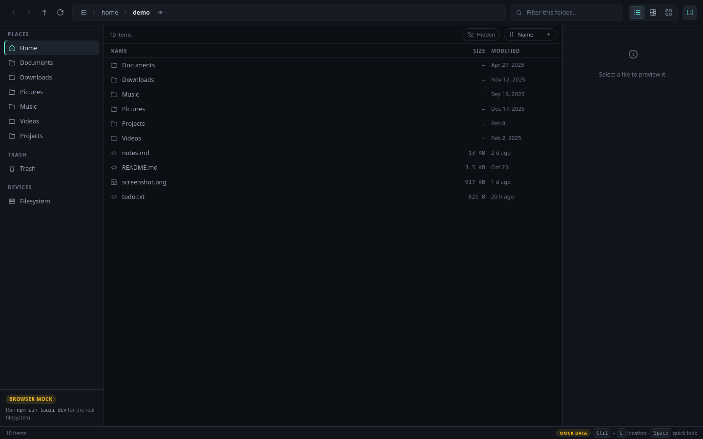
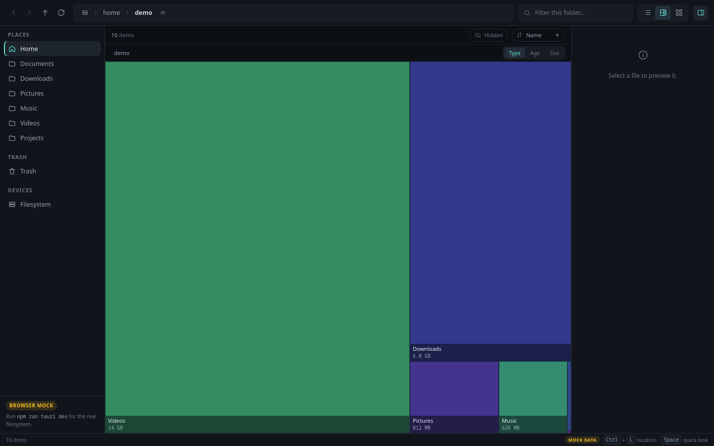
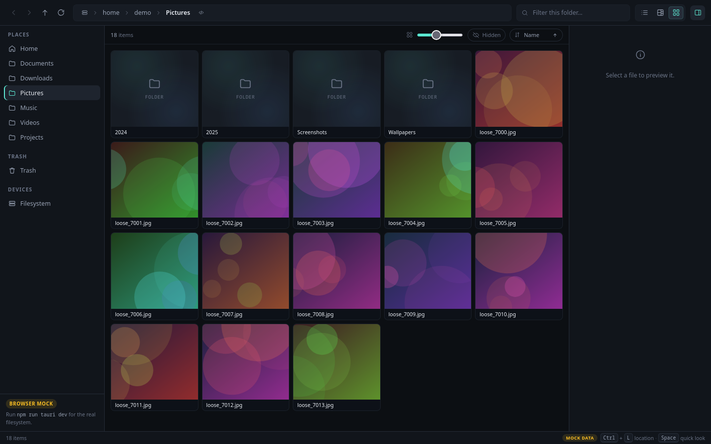

# MatrixFileBrowser

A richly featured, FOSS file browser for Linux — built to make big folders
legible instead of dumping them in a list.

Rust owns the filesystem. A Svelte 5 webview renders it. Views are plugins over
one shared selection model, so the same folder can be a list, a disk-usage map,
or a photo wall without reloading anything.

[](LICENSE)

## Screenshots

| List | Treemap | Mosaic |
| --- | --- | --- |
|  |  |  |

<sub>Screenshots use the built-in deterministic mock backend, which is why the
paths are `/home/demo`.</sub>

## Status

This is **milestone 1**: a read-only browser with three views. It is usable
today, and the rest of the roadmap below is not yet built.

Working:

- Fast, paged, sorted directory listing (Rust, `read_dir` + paging, virtualised in the UI)
- Squarified **treemap** with drill-down, three colour modes and size rollups computed in parallel
- **Mosaic** photo wall with thumbnail-size control and cached thumbnails
- Preview pane, Quick Look overlay, text and image previews
- Navigation history, breadcrumbs, editable location bar, filter, hidden-file toggle
- Places sidebar: home, XDG folders, trash, mounts discovered from `/proc/mounts`
- Debounced filesystem watching that refreshes the open folder
- Keyboard-first operation, dark and light themes, deep-linkable view state

All five milestones are complete. Packaging (Flatpak/AppImage) ships as a
scaffold in `packaging/` and is not yet built in CI.

## Architecture

```
crates/matrix-core        Entry model, paged listing, places, Vfs trait
crates/matrix-thumbs      Thumbnail pipeline + content-addressed disk cache
crates/matrix-aggregate   Parallel, cancellable directory size rollups (rayon)
src-tauri                 Tauri shell: commands, state, filesystem watcher
src                       Svelte 5 + TypeScript frontend
```

Two rules keep the layers honest:

1. **Rust is the only thing that touches the filesystem.** The webview gets
   serialised `Entry` records and paths to cached thumbnails, nothing more.
2. **The UI talks to one `Backend` interface** (`src/lib/api.ts`). The Tauri
   implementation calls commands; a deterministic mock implementation lets the
   entire UI run in a plain browser with no Rust at all.

That second rule is why `npm run dev` alone gives you a working, clickable app.
It is also how the screenshots above were produced.

## Requirements

Fedora / RHEL family:

```sh
sudo dnf install -y gcc gcc-c++ make pkgconf-pkg-config \
  webkit2gtk4.1-devel openssl-devel dbus-devel \
  libappindicator-gtk3-devel librsvg2-devel
```

For AppImage bundles, also install `patchelf` and `fuse` (or `fuse-libs`).

Debian / Ubuntu equivalents:

```sh
sudo apt install -y build-essential pkg-config \
  libwebkit2gtk-4.1-dev libssl-dev libayatana-appindicator3-dev librsvg2-dev
```

Plus [Rust](https://rustup.rs) (1.77+) and Node 20+.

Optional, for extra thumbnail formats: `ffmpeg` (video) and `pdftoppm` from
`poppler-utils` (PDF). Without them those tiles fall back to an icon.

## Getting started

Run everything from the repository root — `src-tauri/` and `package.json` are
siblings, which is what the Tauri CLI expects.

```sh
npm install
```

**Browser-only UI (no Rust, no system libraries):**

```sh
npm run dev
# open http://127.0.0.1:1420
```

**The real app:**

```sh
npm run tauri dev
```

**Build installers** (`deb`, `rpm`, `appimage`):

```sh
npm run tauri build
```

Artifacts land in `src-tauri/target/release/bundle/`.

### Tests and lints

```sh
cargo test -p matrix-core -p matrix-aggregate
cargo clippy --all-targets -- -D warnings
cargo fmt --all --check

npm run check && npm run build
```

## Keyboard

| Key | Action |
| --- | --- |
| `Ctrl+L` | Edit location |
| `Ctrl+F` | Focus filter |
| `Ctrl+1` / `2` / `3` / `4` / `5` / `6` / `7` | List / Treemap / Mosaic / Sunburst / Query / Clusters / Palace |
| `Delete` | Move selection to trash |
| Right-click | Context menu (open, rename, move, trash) |
| `Alt+←` / `Alt+→` | Back / Forward |
| `Backspace` | Parent folder |
| `↑` / `↓` | Move selection |
| `Enter` | Open |
| `Space` | Quick Look |
| `Esc` | Close overlay / leave field |
| `F5` | Reload |

Shift-click and Ctrl-click extend the selection. Double-click opens.

## Deep links

View state lives in the URL hash, so a folder and a view can be linked:

```
#view=treemap&path=%2Fhome%2Fyou%2FPictures
```

## Milestone tracking

| Milestone | Scope | Status |
| --- | --- | --- |
| **M1** | Read-only browser + treemap + mosaic views | ✅ Complete |
| **M2** | Sunburst / radial tree, query & metadata workbench | ✅ Complete |
| **M3** | Semantic clusters (name/type/size) | ✅ Complete |
| **M4** | 3D memory palace (orbitable spatial view) | ✅ Complete |
| **M5** | File operations (rename, move, trash, batch) + packaging scaffold | ✅ Complete |
| **Later** | Archives and MTP/SFTP through the `Vfs` trait, plugin API for third-party views | ⏳ Planned |

M1 ships: fast paged listing, squarified treemap with drill-down and colour modes, mosaic photo wall, preview pane, Quick Look, navigation history, breadcrumbs, filter, hidden files, places sidebar, debounced filesystem watching, keyboard shortcuts, dark/light themes, deep-linkable state, and a deterministic mock backend for browser-only dev.

## License

GPL-3.0-or-later. See [LICENSE](LICENSE).
